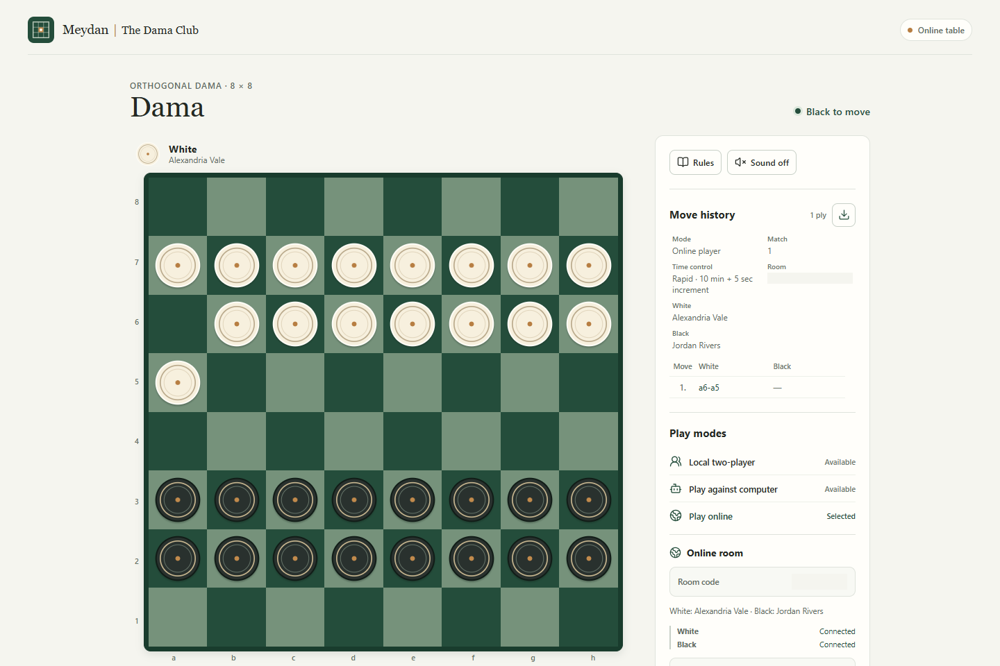

# Meydan | The Dama Club

Meydan is a playable browser implementation of Turkish Dama on an 8 × 8 board. White moves first, with 16 pieces per side. The game opens on the board.

For architecture and code-level behavior, see the [technical implementation reference](docs/TECHNICAL_DOCUMENTATION.tex) (LaTeX source).



## Play modes

- **Local two-player:** two people share one device. You can reverse or cancel an uncommitted move preview, undo a committed ply, and start a new match.
- **Against the computer:** choose White or Black and Easy, Medium, or Hard. The search runs in a browser worker, so it does not run on the main UI thread. A failed worker search can be retried.
- **Online room:** create a room, choose your side and a time control, then invite another player with the six-character room code. A person with the code can join an available player seat or watch as a read-only spectator. A room code is an invitation, not a password or user identity.

Online players can offer, accept, or decline a draw, resign, and vote for a rematch. A rematch begins only after both players agree and swaps their sides. Spectators see the match but cannot move, offer or accept a draw, resign, or vote for a rematch.

Online time controls are **Untimed**, **Rapid (10 minutes + 5 seconds per move)**, and **Blitz (5 minutes + 3 seconds per move)**. The server owns the clocks and results. A disconnect does not pause the active clock. A disconnected player's seat is held for two minutes to allow a reconnect; if the recovery period expires, the server records the disconnection result.

## Rules and attribution

The in-app [Dama rules dialog](src/components/Rules.tsx) describes the rules used by the app. Men move one empty square forward or sideways and capture forward or sideways. Captures are mandatory; when captures are available, a player must choose a complete sequence that captures the greatest number of pieces. Captured pieces leave the board as the sequence proceeds. Kings slide and capture along clear rows or columns. Promotion happens only when the entire turn ends, so reaching the far edge mid-capture does not interrupt the sequence.

The game ends when a player has no legal move. It is drawn when the same position with the same side to move occurs three times, or when each side has one piece left. This setup does not use king-move or lone-king draw counters.

The rules engine is [`@ymir-js/checkers` 0.14.0](https://www.npmjs.com/package/@ymir-js/checkers), using its `turkish` variant. That package is MIT-licensed; its license notice is included with the installed dependency at `node_modules/@ymir-js/checkers/LICENSE` after `npm ci`. Meydan adapts the engine in [`shared/game.ts`](shared/game.ts), and the rule expectations are covered in [`tests/rules.test.ts`](tests/rules.test.ts). The dependency's license does not declare a license for the rest of this application.

## Controls and accessibility

Use a mouse or touch to select a piece and its legal landing squares. Keyboard users can Tab or Shift+Tab between controls. On the board, Tab enters the single focused square, the arrow keys move focus by square, Enter or Space selects a piece or landing square, and Escape cancels the current move preview. These controls continue to work when the board is flipped. Focusable controls have accessible names, and dialogs support keyboard focus and restoration.

The app also provides optional move sounds and reduced-motion styling. Browser audio requires a user gesture; the sound toggle can be changed at any time.

## Move history and scorebooks

Move history is shown during play. **Download scorebook** creates a plain-text `.txt` file in the browser. It contains the mode, match number, time control, player names, moves, and result; an online scorebook also includes the room code. The browser creates this file locally. Review its contents before sharing it.

## Storage and online-service limits

Meydan has no accounts or durable match database. The selected computer difficulty and remembered online nickname are stored in this browser's `localStorage`. The online reconnect credential and room code are stored in this tab's `sessionStorage` so the same tab can resume after a reload. Browser storage can be unavailable or cleared; if the tab cannot save its reconnect identity, a refresh may require rejoining, and a closed or cleared session may not be recoverable.

Online rooms, player/spectator presence, match positions, offers, rematch votes, clocks, and reconnect sessions exist only in the server process's memory. A server restart or deploy loses active matches. Rooms expire after six hours without accepted room activity. One server instance is required; multiple instances are unsupported because they do not share room and reconnect state. Render's free service can sleep after 15 minutes without inbound HTTP requests or WebSocket messages, take about a minute to wake, and may restart, so it can interrupt a game. See [online-service lifecycle](docs/online-service.md) and [deployment limits](docs/deployment.md).

## Run locally

Use Node.js **22.12.0 or newer**. The minimum is declared in [`package.json`](package.json). Install dependencies from this application folder with the committed lockfile:

```powershell
npm ci
npm run dev
```

The integrated development server serves the app and its Socket.IO connection together. It uses port 5173 by default and prints the actual URLs when it starts. If port 5173 is occupied, it chooses a free port. Open the printed `127.0.0.1` URL for this computer. A printed network URL is available only to devices on the same LAN when the network allows it. The local server does not publish the game to the public Internet or change firewall settings.

### Windows launcher

After running `npm ci`, start the same integrated development server from PowerShell:

```powershell
# From meydan/:
pwsh -File .\Start-Meydan.ps1

# Or from the parent workspace:
pwsh -File .\meydan\Start-Meydan.ps1
```

The launcher resolves files from its own directory, checks the Node version in `package.json`, and requires the local development dependencies to be installed. It uses `node.exe` from `PATH` first, then `MEYDAN_NODE_PATH`, then an existing project-local runtime at `.tools/node/node.exe`, `tools/node/node.exe`, or `.runtime/node.exe`. A relative `MEYDAN_NODE_PATH` is resolved from `meydan/`. The launcher does not install packages, download executables, or alter system settings. If dependencies are missing, run `npm ci` from this directory.

## Production, Docker, and Render

Build and start the compiled production server from `meydan/`:

```powershell
npm run build
npm start
```

The build outputs the browser app under `dist/client/` and the server entry at `dist/server/production.js`. `npm start` runs that compiled entry without Vite middleware. It reads the host-provided `PORT` (default 5173 for a local run) and binds to `0.0.0.0`; HTTP and WebSocket traffic use the same server.

The parent workspace contains the [`Dockerfile`](../Dockerfile), [Render Blueprint](../render.yaml), and [Docker context exclusions](../.dockerignore). Build the image from the parent workspace root so the Docker context contains `meydan/`:

```powershell
# From the parent workspace root:
docker build -t meydan .
docker run --rm -p 10000:10000 -e PORT=10000 meydan
```

Render uses this parent-root Docker context, provides `PORT`, and checks `/api/health`. If a rewriting proxy changes the host or scheme, set `PUBLIC_ORIGIN` to the exact public browser origin, such as `https://game.example.com`; do not add a path, query, or fragment. Keep the browser `Origin` unchanged and forward WebSocket upgrades on `/socket.io` to the same instance. The Render file is configured for one instance. The local configuration files do not establish a hosting account or a public deployment. For the alternative of publishing `meydan/` alone, see [deployment root choices](docs/deployment.md#repository-root-choices).

## Verification

From `meydan/`, install the lockfile and run the project checks:

```powershell
npm ci
npm test
npm run typecheck
npm run build
npm run test:e2e
npm run test:e2e:deployment:dev
npm run test:e2e:deployment:production
# Or run the development and production deployment checks in sequence:
npm run test:e2e:deployment
```

The Playwright tests use an installed Microsoft Edge first, then an installed Chrome or Chromium executable. Set `PLAYWRIGHT_CHROMIUM_EXECUTABLE_PATH` to choose a Chromium executable. If no compatible browser is installed, install one with `npx playwright install chromium`. The production deployment suite starts `dist/server/production.js` on a free loopback port and checks the real compiled server, worker, static assets, deep-route SPA fallback, and WebSocket transport; it does not use `vite preview` or Vite middleware. The deployment checks record responsive screenshots at 1440, 1024, 390, and 320 CSS pixels and assert horizontal overflow and control overlap in representative lobby, match, result, and finished-match states. Their screenshots and measurements are under ignored `test-results/deployment-evidence/`. The 1440 × 960 production online-match capture is [`docs/cover.png`](docs/cover.png); the test uses fictional names and masks the room code.

### Latest local evidence

Observed on 2026-10-30 with Node.js 24.22.1 and Microsoft Edge: **133 Vitest tests passed across 8 files; 76 standard Playwright tests passed; 6 development deployment-browser tests and 6 production deployment-browser tests passed.** All five TypeScript project checks passed. The browser runner emitted a `NO_COLOR`/`FORCE_COLOR` environment warning; the checks passed.

This evidence used the existing `node_modules`; it is not a clean install. This environment does not have an npm CLI, so `npm ci` and the `npm run` wrappers could not be verified here. The direct Vite client build passed, but the direct esbuild server-bundle command was blocked when the local runner tried to read `../../..` (`Access is denied`). The production browser checks and a local health/page/asset/WebSocket smoke check used the existing compiled server entry, so a fresh full build remains unverified in this environment. The PowerShell launcher selected Node 24.22.1 but its `tsx` bootstrap stopped on this host with `uv_os_get_passwd returned ENOMEM`; verify the launcher with a standard Windows Node installation. No public deployment has been verified.

See [`tests/README.md`](tests/README.md) for test setup and output locations. See the [parent workspace README](../README.md) for the deployment file layout and clean source export command.
